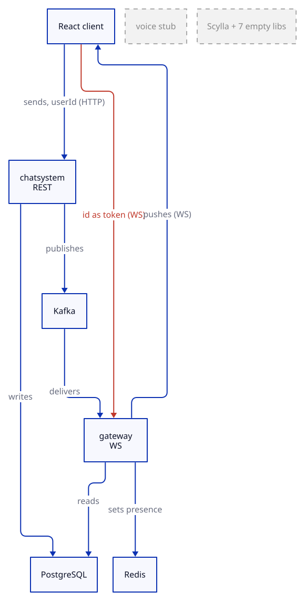
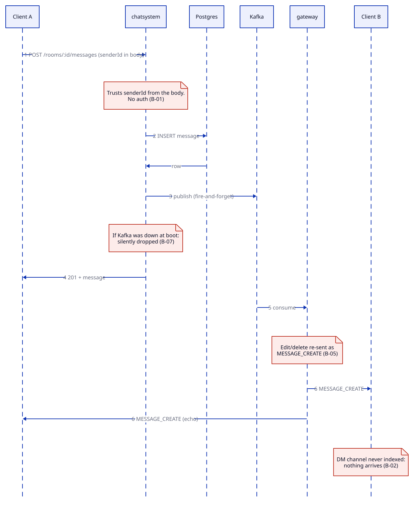
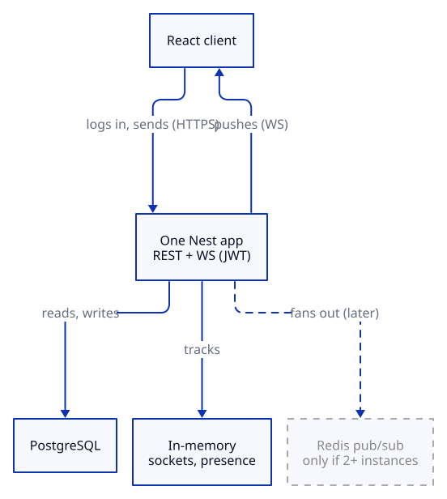

# Chat System — Audit & TODO

Repo: https://github.com/HJB-2000/chatsystem · commit `e62e910e` ("connect the front and back") · audit date 17/10/2026 · read-only audit, nothing in your repo was changed.

Source IDs in `[B-xx]` (backend), `[F-xx]` (front-end), `[R-xx]` (runtime test) point to the raw findings files. Every `file:line` below was re-checked against the repo at this commit. Items I could not confirm are marked *suspected*. Secret values are never printed.

Scope note: the live front-end is the React app (`front-end/react replacement/`). The vanilla JS front-end is legacy, already migrated: it gets a delete item, and what it had that React lacks is listed as migration gaps. Contract checks are against React only.

## 1. Verdict

- **It works technically.** All three apps build, `tsc` is clean, Postgres migrations apply, the seed runs, and the real-time path works live: REST post, then Kafka, then gateway, then the WebSocket client received `MESSAGE_CREATE` [runtime step 7e].
- **It is not a usable chat yet.** There is no login: your identity is a number you type, on REST and on the WebSocket. Anyone can read anyone's DMs and post as anyone with one `curl` [B-01, B-21, B-22, R-01].
- **Features are half-wired.** DMs never arrive live, edit/delete show up as new messages, a new guild or room gets no events until reconnect, the React UI cannot create/edit/delete/DM at all, and voice is a stub [B-02, B-03, B-05, F-08].
- **The repo is heavy and leaky.** `node_modules` (34,566 files), `dist`, the generated client and a `.env` with a DB password are committed; `.gitignore` is empty; lint checks nothing; the 9 tests test nothing.
- **Fix first: add real authentication** (P0-1). Until identity is verified server-side, every other fix is cosmetic.

## 2. Architecture as implemented

Two live processes (`chatsystem` REST, `gateway` WebSocket), one stub (`voice-signaling`), and Kafka used as a one-way pipe between the two live apps. Seven `libs/*` and Scylla exist only as empty shells. In the diagram, red marks the trusted client-supplied identity and grey dashed boxes are unused.



| Component | Port | What it does | State |
|---|---|---|---|
| `apps/chatsystem` | 3000 (`CHAT_PORT`) | REST `/api/*`: all writes | working |
| `apps/gateway` | 3001 (`GATEWAY_PORT`) | WS `/gateway`, consumes Kafka, reads Postgres at identify, presence in Redis | working |
| `apps/voice-signaling` | `process.env.port` (lowercase), default 3000 | returns `Hello World!` | stub [R-07, B-06] |
| `libs/*` (7) | none | empty `@Injectable()` classes, imported by nobody | dead [B-32] |
| Kafka, Redis, Postgres | 9092, 6379/6380, 5432 | pipe, presence keys, all data | used |
| ScyllaDB | none | not in compose, not imported | absent [R-11] |

### Message send, and where it breaks

Red notes in the diagram mark failure or trust points.



| Step | Where | What goes wrong |
|---|---|---|
| 1 | `apps/chatsystem/src/app.controller.ts:106-116` | `senderId` comes from the body, nobody checks it [B-01] |
| 3 | `apps/chatsystem/src/chat.service.ts:328` | `void this.kafka.publish(...)`: if the producer never connected (`kafka.service.ts:22-30`) the message is stored but never pushed [B-07, B-17] |
| 5 | `apps/gateway/src/app/events.consumer.ts:19-31` | edit/delete events are re-sent as `MESSAGE_CREATE` [B-05] |
| 6 | `apps/gateway/src/app/session-loader.service.ts:54-58` | only guild channels are indexed, so a DM is never delivered live [B-02] |
| 6 | same file, frozen at identify | channels created or guilds joined after connect get nothing [B-03] |

## 3. TODO — ordered by priority

Order inside a priority is the order to do it. Each item: what, where, why, simplest fix.

### P0 — security / blocking (do before anything is shown to anyone)

- [ ] **P0-1 Add real authentication end to end** [B-01, B-04, B-21, F-04, R-01, R-02]. Where: all routes in `apps/chatsystem/src/app.controller.ts`; `chat.service.ts:69` (`updateUser`, no ownership check); `apps/gateway/src/app/session-loader.service.ts:14-25` ("token == user id", `ID_RE`); `front-end/react replacement/src/ui.jsx:6` and `src/realtime/gatewayClient.ts:73` (sends the id as token). Why: `POST /api/rooms/1/messages {"senderId":"3"}` returned 201 as user 3, `PATCH /api/users/1` with no credential returned 200, and WS IDENTIFY with token `2` returned a full READY for user 2 (runtime test). Simplest fix, in order: (a) add `passwordHash` to `user` and `POST /auth/register` and `POST /auth/login` using `argon2` and `@nestjs/jwt` (both already installed, never imported); (b) a global `AuthGuard` that verifies the JWT and sets `req.user.id`; (c) delete `userId`/`senderId` from every body, query and path and read `req.user.id` instead; (d) `PATCH users/:id` only when `:id === req.user.id`; (e) `SessionLoader.load()` verifies the JWT instead of `ID_RE` and rejects otherwise; (f) React: login screen, keep the token in memory or `sessionStorage`, `Authorization: Bearer` in `chatApi.ts`, token in IDENTIFY, drop `?userId=`.
- [ ] **P0-2 Stop DM snooping and forced friendships** [B-22]. Where: `app.controller.ts:166-183` (`GET`/`POST dms/:userId/:partnerId`), `app.controller.ts:190` (`POST friends/:userId/:partnerId`); `chat.service.ts:445-459`, `chat.service.ts:461-478` (`getOrCreateDm`), `chat.service.ts:481` (`addFriend`). Why: both ids come from the URL and nobody checks the caller is one of them, so any user can read any DM history and create DMs and friendships with anyone. Fix: after P0-1 use `req.user.id` as the caller, ignore the path `:userId`, require an existing friendship (or a request/accept step) before DM access.
- [ ] **P0-3 Remove the open "join any guild" endpoint** [B-25]. Where: `app.controller.ts:76` (`POST rooms/:id/join`), `chat.service.ts:198`. Why: no invite check, channel ids are sequential, so anyone can join every guild by counting. Fix: delete the route (the React `chatApi.ts:29` `joinRoom` is never called by the UI) and keep `invites/:token/join` as the only way in.
- [ ] **P0-4 Remove the committed `.env`, rotate the password, bind ports to localhost** [B-23, R-05, R-06]. Where: `.env` (tracked), `infra/postgres/docker-compose.yml:11,26,38`. Why: the DB password is in git history; Postgres, Redis (no password) and Kafka are published on all interfaces, which on a school LAN means open to the room. Fix: `git rm --cached .env`, rotate the password (section 7), keep `infra/postgres/env.example`, publish ports as `127.0.0.1:${...}:...`, and merge the duplicated keys (`REDIS_PORT`, `REDIS_URL`, `KAFKA_*`, `PORT`, `GATEWAY_PUBLIC_URL` appear twice; the first block says Redis 6379, the second 6380).
- [ ] **P0-5 Limit abuse on the WebSocket and REST** [B-26]. Where: `apps/gateway/src/main.ts:8` (`new WsAdapter(app)` with defaults), `apps/gateway/src/app/gateway.ts:104` (`JSON.parse` before any size check), `apps/gateway/src/app/info.controller.ts:18` (`/gateway/stats` public). Why: `ws` accepts up to 100 MiB frames by default; one client can exhaust memory; no rate limit on anything except typing. `app/dto.ts` (class-validator limits) is imported nowhere. Fix: pass `maxPayload: 4096` to the WS adapter, cap sockets per user, protect `/gateway/stats` with the guard, add `@nestjs/throttler` on REST, and either wire `dto.ts` in or delete it.

### P1 — broken features (the app does not do what it claims)

- [ ] **P1-1 Make DMs work live** [B-02, F-08]. Where: `session-loader.service.ts:54-58` indexes guild channels only; React `ui.jsx:472` (`onSelectContact={() => setDialog('dm')}`) opens a placeholder instead of the DM. Why: DM messages and typing are never pushed, and the DM screen cannot be opened. Fix: in `load()` also read `directChannelMember` for the user and add each `channelId` to `channels`; in React, on contact click call `GET /api/dms/:userId` then open that room.
- [ ] **P1-2 Refresh membership after the socket is open** [B-03]. Where: `session-loader.service.ts` (snapshot at identify), `registry.service.ts:45-50` (a user's second socket returns early and never refreshes). Why: after joining a guild, creating a room or adding a friend you receive nothing until reconnect, which looks like "chat is broken". Fix: simplest is to have the gateway check membership lazily with a few-seconds cache instead of a frozen map; otherwise emit a `membership` event from `chatsystem` and add the channel to that user's sessions.
- [ ] **P1-3 Honour edit and delete events, and expose them in the UI** [B-05]. Where: `events.consumer.ts:19-31` (always `Evt.MESSAGE_CREATE`), `chat.service.ts:344-347` and `:361-364` (publish `MESSAGE_EDIT`/`MESSAGE_DELETE`), React `ui.jsx:417` (handles only `MESSAGE_CREATE`). Why: an edit shows up as a second message, a delete shows up as a new message. Fix: switch on `v.type` in `onMessage`, add `MESSAGE_UPDATE`/`MESSAGE_DELETE` to `Evt` in `protocol.ts`, do not store them in the replay buffer as creates, handle them in the client; add edit/delete buttons in React (backend routes exist, `app.controller.ts:130-146`).
- [ ] **P1-4 Filter incoming messages by the open room** [F-02]. Where: `ui.jsx:417-421`. Why: the WS handler appends every message from every joined channel to the room currently displayed. Fix: `roomRef.current = room` and `if (String(event.channel_id) !== roomRef.current?.id) return;` (optionally bump an unread counter for the others).
- [ ] **P1-5 Make the React env config actually work** [F-01, F-09, R-09]. Where: `src/api/chatApi.ts:3-5`, `src/realtime/gatewayClient.ts:10`, `ui.jsx:6` read `globalThis.__NEXUS_CONFIG__`, which nothing defines; defaults are hardcoded `localhost:3000/3001`. Why: `VITE_API_URL` and friends are silently ignored. Fix: use `import.meta.env.VITE_API_URL` / `VITE_GATEWAY_URL`, delete `__NEXUS_CONFIG__`. Optional: fetch `POST /api/gateway/url` once instead of hardcoding the WS URL.
- [ ] **P1-6 Make real-time delivery not silently lossy** [B-07, B-17, B-18]. Where: `apps/chatsystem/src/kafka.service.ts:22-30` (connects once at boot, `connected` stays false forever on failure), `chat.service.ts:328`. Why: start `chatsystem` before Kafka, or restart Kafka, and every message is stored but never pushed, with only a WARN log. Fix: either connect lazily with retry inside `publish`, or (recommended, section 5) remove Kafka and call the gateway code in-process. The client should dedupe by `message_id` and refetch history on reconnect.
- [ ] **P1-7 Return 400/404, not 500, on bad input** [R-03, B-20, B-19]. Where: `BigInt(...)` everywhere in `chat.service.ts` (for example `:55`, `:304-306`); no `ValidationPipe` in `apps/chatsystem/src/main.ts`. Why: `GET /api/users/abc` is a 500, `POST /api/rooms/1/messages {}` is a 500, `GET .../messages` without `userId` is a 500. Fix: DTO classes plus `app.useGlobalPipes(new ValidationPipe({ whitelist: true, transform: true }))`, a small `ParseBigIntPipe`, one exception filter mapping Prisma P2002/P2003/P2025. Reuse the create-message length check (4000, `:309`) in `editMessage` (`:333-343` only trims).
- [ ] **P1-8 Scope reads to the caller** [B-27, B-28]. Where: `app.controller.ts:29-37` (`GET users`, `GET users/:id`), `chat.service.ts:160-168` (rooms of a guild returned to non-members with `lastMessage`), `chatsystem/src/main.ts:9` (`origin: true`), `gateway/src/main.ts:9` (`enableCors()`). Why: any caller can list users and read room previews of private guilds. Fix: after P0-1 list only the caller's own memberships, strip `lastMessage` for non-members, allow-list the front-end origin from env, check `Origin` in the WS upgrade.
- [ ] **P1-9 Fix React reconnect, resync and error handling** [F-05, F-06, F-07]. Where: `gatewayClient.ts:18` and `:93` (`reconnectAttempt` is never reset, so after a few drops every retry waits 15 s), `:19` and `:81` (one global `last-message-id` for all users and channels), `:61` (`JSON.parse` unguarded), `ui.jsx:346` (toast timer never cleared). `READY.resync` is ignored. Fix: `reconnectAttempt = 0` on READY, key the cursor by user id, refetch the room when `resync` is true, try/catch the parse, keep one toast timer in a ref, stop retrying on auth-failure close codes.
- [ ] **P1-10 Room previews say "Unknown: ..."** [B-08]. Where: `chat.service.ts:84-93` loads the last message without `author`, while `shapeRoom` reads `last.author?.username` at `:109` (also `:32`). Fix: `include: { author: { select: { username: true } } }` on the `messages` relation.
- [ ] **P1-11 Unread badges never go down** [B-09]. Where: `chat.service.ts:425-427` counts every message ever sent by the partner; `app.controller.ts:185-188` (`PATCH dms/.../read`) returns `{ok:true}` and does nothing. Fix: store `lastReadMessageId` per (channel, user), or drop the badge until you do. Gateway `ACK` state (`gateway.ts:223-227`) is stored and read by nothing: delete it or use it.
- [ ] **P1-12 One source of truth for presence** [B-12, B-13]. Where: REST reads `user.lastPresence` (`chat.service.ts:65`, `:388`, written at `:400`), the gateway writes Redis (`presence.service.ts`). Why: the roster shows wrong status; with 2+ gateway instances the last local socket closing publishes `offline` for a user connected elsewhere (`gateway.ts:84-85`, reasoned from code, not run); a crash leaves `online` for the 300 s TTL. Fix: keep presence only in the gateway (memory, or Redis) and have REST not return it; document "one gateway instance".
- [ ] **P1-13 Close the migration gaps from the vanilla app** (section 4). The React UI has no create guild/room, no invites, no profile edit, no edit/delete, no DM screen, no friends. Backend routes exist for all of them. Do them one by one after P0.
- [ ] **P1-14 Voice: remove the fake huddle until it is built** [B-06, F-08, R-07]. Where: `ui.jsx:214-216` and `:488` (button toggles local state, `00:00` timer is fake, `VOICE_STATE_UPDATE` is ignored), `chat.service.ts:501-519` (flips a DB column, returns a placeholder `wss://sfu.local.example/stream` at `:519`), `apps/voice-signaling`. Fix: remove the button and the stub app, or implement a real relay (section 5).
- [ ] **P1-15 Untrack build output and dependencies** [B-37, F-13]. See section 7 for the commands and `.gitignore`. Classed P1 because every `npm install` currently produces a huge diff and `dist/` is already rewritten by a build.

### P2 — quality

- [ ] **P2-1 Make lint real** [R-04, B-39]. `package.json:20` runs `oxlint --type-aware src/ test/`, directories that do not exist at the root (code is under `apps/` and `libs/`): output is `No files found to lint`, exit 1. Fix: `oxlint apps libs`.
- [ ] **P2-2 Replace the boilerplate tests** [R-04, B-39]. See section 6.
- [ ] **P2-3 Fix schema/migration drift and names** [B-10, B-11, R-08]. `prisma/schema.prisma:111-112` declares two FKs on `message.channel_id` (`message_channel_id_fkey` and `message_dm_channel_id_fkey`), but `prisma/migrations/20261009053621_init/migration.sql:74` drops the first and the second is never created; the first and third migrations are both named `init`, and `migrate diff` reports a missing index on `direct_channel_member(channel_id)`. No real data exists, so squash to one `init` generated from the final schema. Simpler schema: one `Channel` table with nullable `guildId` for DMs.
- [ ] **P2-4 Make the `.env` ports consistent** [R-06, B-15, F-03 *suspected*]. `.env` sets only `PORT=3001`, while `chatsystem/src/main.ts:10` uses `CHAT_PORT ?? PORT ?? 3000` and `gateway/src/main.ts:11` uses `GATEWAY_PORT ?? PORT ?? 3001`. `npm run start:dev` sets both explicitly (`package.json:12`), so it works; starting the apps individually collides. Fix: `CHAT_PORT`, `GATEWAY_PORT`, `VOICE_PORT` in `env.example`. Also remove `app.useStaticAssets(join(process.cwd(),'client'))` (`chatsystem/src/main.ts:8`, the directory does not exist).
- [ ] **P2-5 Delete dead code and dependencies** [B-32, B-35, B-36, R-11]. Section 5.
- [ ] **P2-6 Clean the React package** [F-14, F-13]. `package.json:12-16`: all deps are `"latest"`, build tools belong in `devDependencies`, `mdb-react-ui-kit` is never imported, there is no `vite.config.js` (add one with `react()` and a dev proxy for `/api`), `.ts` files are never type-checked (no `tsconfig`, no `typescript`), `ui.jsx` is a 539-line monolith. Fix: pin with `^`, remove the dead dep, add the config, split `ui.jsx` into components.
- [ ] **P2-7 Fix small data races** [B-14, B-18]. `getOrCreateDm` (`chat.service.ts:461-478`) is check-then-create without a transaction: wrap in `$transaction` and catch the unique violation. `GET dms/:userId` creates a DM row for every friend (`:419`): create on first send instead. The client should sort by `message_id`.
- [ ] **P2-8 Invites: expiry and revoke** [B-29]. `chat.service.ts:11,218-225`: codes are strong (6 random bytes) but never expire and cannot be revoked; `expiresAt` exists in the schema and is never set or checked.
- [ ] **P2-9 Remove fake UI** [F-16, F-15]. `ui.jsx:254` turns attached files into the text `Attachment: <name>`; `ui.jsx:355` toasts "Message sent" on every send; Copilot, notifications, top search and "Live Study Rooms" have no backend; the title says "NexusCampus" while the repo is `chatsystem`.
- [ ] **P2-10 Write a real README** [B-38]. The current `README.md` is the unmodified Nest template. Cover prerequisites, `docker compose up`, `prisma migrate deploy`, `db:seed`, `npm run start:dev`, ports.
- [ ] **P2-11 Pin the toolchain and add a production start for the gateway** [B-40]. `start:prod` starts only `chatsystem`.
- [ ] **P2-12 Investigate the startup warning** [R-10, *suspected*]. `TimeoutNegativeWarning: -1792257788372 is a negative number` appears at startup of both apps; the magnitude equals the current epoch in ms, so a timer is computed as `0 - Date.now()`. Not traced to a line.
- [ ] **P2-13 Unused schema and missing flows** [B-16, B-35]. `capacity` is stored and never enforced, `memberCount` is incremented (`chat.service.ts:211`, `:239`) and never decremented, there is no leave/kick/delete flow. Drop the unused columns (`Role`, `roleIds`, `embeds`, `attachments`, `categoryId`, `capacity`) or implement them.

Totals: **P0 = 5, P1 = 15, P2 = 13** (33 items). Not a TODO: B-31 (no SQL injection, Prisma is parameterised) and F-10/F-11 (no XSS found in React or vanilla).

## 4. Front-end contract (React vs backend) and migration gaps

### Contract table (React app only)

| React call | Backend | Status |
|---|---|---|
| `GET /api/users/:id` | `app.controller.ts:34` | OK |
| `GET /api/collectives?userId` | `:45` | OK (types omit `roomCount`) |
| `GET /api/collectives/:id/rooms?userId` | `:55` | OK |
| `GET /api/dms/:userId` | `:166` | OK, but the DM screen is never opened (P1-1) |
| `GET /api/rooms/:id/messages` | `:86` | OK; `before` supported, UI never passes it (no pagination) |
| `GET /api/rooms/:id/members` | `:81` | OK |
| `POST /api/rooms/:id/messages` | `:106` | OK, `senderId` self-asserted (P0-1) |
| `POST /api/rooms/:id/join` | `:76` | defined in `chatApi.ts:29`, never called; endpoint should be deleted (P0-3) |
| `POST /api/channels/:id/join-voice` and `leave-voice` | `:149`, `:154` | path OK; UI toggles local state only, no media |
| WS `ws://localhost:3001/gateway` | `@WebSocketGateway` path `/gateway` | OK, URL hardcoded (P1-5) |
| op 10 HELLO, op 2 IDENTIFY, op 1/11 heartbeat | gateway | OK; token = user id (P0-1) |
| op 3 presence | `onPresence` | OK, sent only on tab visibility |
| op 8 typing | `onTyping` | `sendTyping` defined (`gatewayClient.ts:50`), never called |
| `MESSAGE_CREATE`, `PRESENCE_UPDATE` | emitted | handled; `MESSAGE_CREATE` not filtered by room (P1-4) |
| `READY.resync` | emitted | ignored (P1-9) |
| `TYPING_START`, `VOICE_STATE_UPDATE` | emitted | no UI handler |
| Search, Copilot, notifications, file upload, Unsplash images | none | UI with no backend: remove or build |

All `app.controller.ts` line numbers above are the route decorator lines. Contract checks were done by reading and by `vite build`; the React app was not clicked through in a browser.

### Migration gaps from the vanilla app (backend exists, React has no UI)

| Feature | Backend route | Todo |
|---|---|---|
| DM history, send, open DM | `GET/POST /dms/:u/:p` (`app.controller.ts:171,176`) | P1-1 |
| Edit and delete own message | `PATCH/DELETE /rooms/:r/messages/:m` (`:130,139`) | P1-3 |
| Create guild ("collective") | `POST /collectives` (`:50`) | P1-13 |
| Create room | `POST /collectives/:id/rooms` (`:60`) | P1-13 |
| Create invite, join by invite | `POST /collectives/:id/invites`, `POST /invites/:token/join` (`:65`, `:70`) | P1-13 |
| Profile edit | `PATCH /users/:id` (`:39`) | P1-13 |
| Add friend | `POST /friends/:u/:p` (`:190`) | P1-13 |
| Presence status picker | `PATCH /users/:id/presence` (`:160`) | P1-13 |
| Reactions, pins, replies, mentions | none in the backend either | do not migrate |

## 5. Over-engineering

Fairness first: if your subject (for example a ft_transcendence-style project) requires a microservices architecture, keep the split. Everything below is compatible with "keep `chatsystem` and `gateway` as two services" except where noted. I cannot see your subject, so treat the Kafka item as a choice, not an error.

| # | What exists | What it costs | Simpler replacement |
|---|---|---|---|
| 1 | **Kafka + Redis between two Nest apps** [B-33]. Kafka is a one-way pipe from `chatsystem` to `gateway`, with one consumer group per gateway process (`gateway-<uuid>`, a dead group per restart); Redis holds one presence key per user, read by the gateway only. | 2 extra containers (about 700 MB idle), startup ordering, a "stored but not delivered" failure mode (P1-6), duplicates on rebalance. | **If microservices are not required:** one Nest process (REST + WS), call `registry.toChannel()` after `message.create`, presence in a `Map`. **If they are required:** keep the split, drop Kafka, have `chatsystem` call the gateway over HTTP or use Redis pub/sub on one channel, and keep Redis only if you run 2+ gateways. |
| 2 | **7 empty `libs/*`** (`common`, `config`, `database`, `kafka`, `redis`, `scylla`, `snowflake`) with tsconfig paths and specs, plus unused deps: `cassandra-driver`, `socket.io`, `@nestjs/platform-socket.io`, `@nestjs/passport`, `passport-jwt`, `@nestjs/config` and more [B-32]. (`@nestjs/jwt` and `argon2` are needed for P0-1: keep them.) | Install time, audit surface, misleading architecture docs. Nothing under `apps/` imports `@app/*`. | Delete the libs and unused deps. If you want a shared module later, one `libs/db` holding the Prisma service. |
| 3 | **`voice-signaling`** scaffold and the DB-flag voice join [B-06, R-07]. Listens on lowercase `process.env.port`, `GET /` returns `Hello World!`; `chat.service.ts:501-519` only flips `voiceChannelId`. | A third app that looks like a feature, a port clash with `chatsystem`, a fake UI button. | Delete it until WebRTC signaling is actually built. If voice is required: a minimal WS relay for offer/answer/ICE inside the gateway. |
| 4 | **Postgres + Scylla + Snowflake in the design** [R-11, B-35]. Messages live in Postgres with serial ids; `libs/snowflake` is an empty class; Scylla is not started and not imported. | The docs promise a stack the code does not have. | Say "Postgres only", delete Scylla and snowflake, drop unused columns. |
| 5 | **Hand-rolled gateway state** [B-34]: four indexes in `registry.service.ts`, a replay ring buffer of 100 frames per channel, slow-consumer eviction, ack tracking nobody reads, Discord-style op codes. | About 140 lines of subtle state that is already wrong (B-03, B-13). | Socket.IO rooms (`socket.join('channel:ID')`) give fan-out, heartbeat and reconnect; refetch history on reconnect instead of in-memory replay. Or keep raw `ws` and delete the replay and ack parts. |
| 6 | **Duplicate routes and aliases** [B-36]: `/rooms/:id/messages` and `/channels/:id/messages` (GET and POST), `collectives` vs `guilds`, `senderId ?? userId`, `message ?? content`. | Twice the surface to secure and test. | One route per action, one vocabulary. |
| 7 | **Two front-ends, a zip of the old one, a handbook PDF** [F-13, F-12]. Vanilla `front-end/*.js`, `front-end/files.zip`, `src/react-handbook.pdf` (2 MB in `src/`). Vanilla `Api.js` also silently falls back to `mock.js` on any error, so a dead backend looks alive. | Confusion, 1,514 tracked `node_modules` files in the React folder, stale duplicates. | Delete vanilla, the zip and the PDF (migrate the gaps first, section 4). |
| 8 | **Bleeding-edge toolchain** [B-40]: Nest 12, Prisma 7 with the generated client committed, TypeScript 6, rspack builder, React and Vite on `latest`. | Non-reproducible installs; rspack never type-checks (`tsc` is clean today). | Pin versions; keep the builder you can debug. |

### Simplified architecture (recommended)

One app, Postgres, in-memory presence. The dashed box is for scaling out later only.



If the split is mandatory, the same picture holds with two boxes (`api` and `gateway`) and one direct HTTP or Redis pub/sub arrow between them. The point is to remove Kafka, the empty libs and the voice stub, not the separation of concerns.

## 6. Testing gaps

Measured: `npm test` passes **9 suites / 9 tests**, but all are generator stubs (`Hello World!` and `should be defined`). `ChatService` (547 lines), the controller, the gateway and the protocol have no test. `npm run lint` finds no files (P2-1). The 3 `apps/*/test/app.e2e-spec.ts` files exist and were not run. `stress-tests/core-path.stress.ts` is the only real test and needs the whole stack. `jest.config.ts` runs with `--experimental-vm-modules` on a CJS setup (*suspected* misconfiguration, not investigated).

Tests worth writing first, in this order:

1. **Auth guard** (after P0-1): a request with no token returns 401; a request with a valid token but a spoofed `senderId` in the body stores the message under the token's user. This is the regression test for the worst bug.
2. **Membership rules in `ChatService`** with Prisma mocked: a non-member cannot post to or read a channel; a member can (`createRoomMessage`, `assertCanReadChannel`).
3. **Edit/delete ownership**: editing or deleting another user's message returns 403; empty content on edit is rejected (P1-7).
4. **DM access**: a user who is not a party to the DM cannot read it (P0-2).
5. **Gateway delivery**: `onMessage` sends to every session indexed on that channel and to nobody else; the identify path closes the socket on a bad token. Add `MESSAGE_DELETE` once P1-3 lands.

Also keep the live smoke used in this audit (WS identify, REST post, expect `MESSAGE_CREATE`) as the e2e test.

## 7. Repo hygiene

Checked with `git ls-files`:

- [ ] `node_modules/` tracked: **34,566 files**. Also `front-end/react replacement/node_modules` (1,514 files) and its `dist/`.
- [ ] `dist/` tracked (5 files: `dist/apps/chatsystem/main.js`, `dist/apps/gateway/main.js`, their maps, `dist/tsconfig.tsbuildinfo`); a build modifies them.
- [ ] `generated/prisma/` tracked (generated client). Run `prisma generate` in `postinstall` instead.
- [ ] `.env` tracked (DB user, password, URLs).
- [ ] `.gitignore` is 7 bytes and contains only the text `(empty)`, which ignores nothing.
- [ ] Stray files: `.backend.md.swp` (vim swap), `some_test.js`, `some_test.ts`, `tmp.md`, `PyTest/WebSocket.py` (a socket.io client for a protocol this server does not speak), `front-end/files.zip`, `front-end/react replacement/src/react-handbook.pdf`, `architecture/*.png` and `architecture/chatsystem.pdf`, `architecture.md` (a pasted `ls`), `backend.md` (tutorial notes), `apps/gateway/gatway_doc.md`, `README.md` (unmodified Nest template).

Ready-to-paste `.gitignore`:

```
node_modules/
dist/
generated/
coverage/
.env
.env.*
!.env.example
*.swp
*.zip
*.log
.DS_Store
```

Untrack commands (run from the repo root; they remove files from the index only, the files stay on disk):

```
git rm -r --cached node_modules dist generated .env .backend.md.swp front-end/files.zip
git rm -r --cached "front-end/react replacement/node_modules" "front-end/react replacement/dist"
git rm --cached some_test.js some_test.ts tmp.md
git add .gitignore && git commit -m "chore: stop tracking dependencies, build output and .env"
```

**Warning: the committed `.env` password is already in git history.** Removing the file from the index does not remove it from old commits. Do this in order: (1) rotate the Postgres password now (change it in your local `.env` and in the compose volume, or recreate the DB), (2) `git rm --cached .env` as above, (3) optional: rewrite history (`git filter-repo --path .env --invert-paths`, and the same for `node_modules` and `dist` to shrink `.git` from about 204 MB) and force-push. The rewrite is optional because it is a dev password and the repo has no real data, but rotating is not optional, especially if the password was ever reused elsewhere. Never put the new value in the repo; commit only `infra/postgres/env.example`.

## 8. Appendix — how this was verified

Method: static read of the backend and both front-ends at commit `e62e910e`, then a real build, boot and test run on 17/10/2026 with infra on override ports in an isolated compose project (nothing of yours was modified; tracked `dist/` files rewritten by the build were restored). Node v24.21.0, nest CLI 12.0.8. Scylla was not started because no app imports it. Afterwards, every `file:line` in this report was re-grepped against the repo. Line numbers in the raw `backend.md` were wrong in places (for example it cited `session-loader.service.ts:331`, but that file has 66 lines; the real lines are 14-25 and 54-58) and are replaced here by the true ones.

| Step | Result | Key line |
|---|---|---|
| Toolchain (`nest --version`) | PASS | 12.0.8, committed `node_modules` works |
| Build `chatsystem`, `gateway`, `voice-signaling` | PASS (3/3) | rspack compiled successfully |
| `tsc --noEmit` | PASS | rc 0 (rspack does not type-check, tsc does) |
| `npm test` | PASS | 9 suites, 9 tests, all boilerplate |
| `npm run lint` | FAIL | `No files found to lint`, rc 1 |
| Infra up (postgres, redis, kafka) | PASS | all healthy |
| `prisma migrate deploy` | PASS | 3 migrations applied |
| `prisma migrate diff` | FAIL (minor) | missing index plus 2 FKs on `message.channel_id` |
| Seed | PASS | 3 users, guilds, rooms, messages |
| Boot `chatsystem` | PASS | all routes mapped, kafka producer connected |
| Boot `gateway` | PASS | one transient "group coordinator is not available", then consuming |
| Boot `voice-signaling` | PASS (stub) | only `GET /` returns `Hello World!` |
| REST smoke | PASS | 200/201 with seed data |
| WS smoke (IDENTIFY token `2`, REST post as user 1) | PASS | READY then `MESSAGE_CREATE`: Kafka to gateway to WS works |
| Spoof test | confirmed | `senderId:"3"` accepted; `PATCH /users/1` with no credential returned 200 |
| Bad input | confirmed | 500 on `/users/abc`, missing `userId`, empty body |
| React `vite build` | PASS | 19 modules, JS 163 kB; not browser-tested |
| Teardown | PASS | no containers, volumes or ports left |

Not verified: browser behaviour of the React app (read and built only), multi-instance gateway behaviour, Kafka restart behaviour (P1-6 is reasoned from code), and every item marked *suspected* above.
