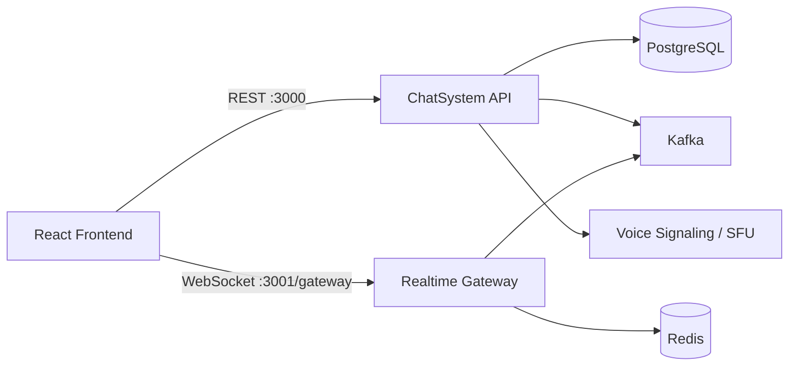

# Frontend Integration Roadmap

This roadmap connects the React frontend to the ChatSystem REST API and Gateway so the application can provide a Discord-like chat experience.

## Current State

The React app is currently a static UI:

- Servers, rooms, contacts, and the current user are hard-coded in `src/ui.jsx`.
- Messages are stored only in React state.
- The composer does not send messages to the backend.
- API helpers exist in the older frontend at `../../Api.js`, but are not yet used by the React replacement.
- The Gateway WebSocket implementation exists under `apps/gateway/src/app`.
- The Gateway currently authenticates with a numeric user ID as a temporary token.
- The voice-signaling service is currently only a stub.

The backend already provides REST operations for users, collectives, rooms, messages, DMs, presence, invites, and voice membership.

## Target Architecture



Responsibilities:

- **ChatSystem REST API**: persistence, history, permissions, and resource management.
- **Gateway WebSocket**: realtime messages, presence, typing, and voice-state events.
- **PostgreSQL**: users, guilds, rooms, memberships, friendships, and messages.
- **Kafka**: event distribution between ChatSystem and Gateway.
- **Redis**: presence and realtime session state.
- **Voice service/SFU**: actual audio transport.

## Phase 1: Establish Local Connectivity

Create frontend environment configuration:

```env
VITE_API_URL=http://localhost:3000
VITE_GATEWAY_URL=ws://localhost:3001/gateway
VITE_USER_ID=your-test-user-id
```

Add a Vite proxy or use absolute URLs so frontend requests reach the backend instead of the Vite development server.

Move the existing API helpers into the React project:

```text
src/api/http.js
src/api/chatApi.js
src/realtime/gatewayClient.js
src/state/chatStore.js
```

Start the backend dependencies and services:

```bash
cd ~/ChatSystem/old-version
cp infra/postgres/.env.example .env
infra/postgres/db.sh up
infra/postgres/db.sh migrate --name init
npm run start:dev
```

Expected service addresses:

```text
ChatSystem API: http://localhost:3000
Gateway:        ws://localhost:3001/gateway
```

## Phase 2: Replace Mock Bootstrap Data

Replace the mock values in `src/ui.jsx` with API data.

Startup sequence:

1. Load the current user with `GET /api/users/:id`.
2. Load collectives with `GET /api/collectives?userId=:userId`.
3. Select the first collective.
4. Load rooms with `GET /api/collectives/:id/rooms?userId=:userId`.
5. Load DMs with `GET /api/dms/:userId`.
6. Select the first text room.
7. Load messages with `GET /api/rooms/:roomId/messages?userId=:userId`.

Use a normalization layer so UI components do not depend directly on backend field names.

| UI concept | Backend fields |
|---|---|
| Server | `id`, `name`, `iconUrl` |
| Room | `id`, `name`, `topic`, `type`, `capacity` |
| Room occupancy | `memberCount`, `capacity` |
| Message | `id`, `senderId`, `senderName`, `message`, `createdAt` |
| Contact | `partnerId`, `username`, `channelId`, `lastMessage` |

## Phase 3: Connect Text Messaging

Send messages through:

```text
POST /api/rooms/:roomId/messages
```

Request body:

```json
{
  "senderId": "current-user-id",
  "message": "hello"
}
```

Use the response to update the message list. The Gateway also publishes the persisted message, so the frontend must deduplicate by message ID instead of blindly appending both copies.

Recommended message state:

```js
{
  byId: {},
  orderedIdsByChannel: {},
  loadingByChannel: {},
  hasMoreByChannel: {},
  error: null
}
```

Update `MessageArea` to render:

- Avatar
- Username
- Timestamp
- Message content
- Edited state
- Attachments
- Edit and delete actions for the current user
- Loading and empty states

## Phase 4: Implement the Gateway Client

The Gateway protocol is defined in `apps/gateway/src/app/protocol.ts`.

Connection sequence:

1. Open `ws://localhost:3001/gateway`.
2. Receive `HELLO`.
3. Send an identify frame:

```json
{
  "op": 2,
  "d": {
    "token": "USER_ID",
    "last_message_id": "OPTIONAL_LAST_MESSAGE_ID"
  }
}
```

4. Receive `READY`.
5. Start the heartbeat interval received from `HELLO`.
6. Handle dispatch events.

The client should support:

- Automatic reconnect with backoff
- Heartbeat and heartbeat acknowledgement
- Authentication failure handling
- Last received message ID persistence
- Duplicate event protection
- Connection status in the UI
- Cleanup on logout and page unload

Required events:

```text
READY
MESSAGE_CREATE
PRESENCE_UPDATE
TYPING_START
VOICE_STATE_UPDATE
```

Suggested client API:

```js
connect(token)
disconnect()
sendPresence(status)
sendTyping(channelId)
ack(channelId, messageId)
subscribe(eventName, handler)
```

## Phase 5: Load and Update Room Members

When a room is selected, call:

```text
GET /api/rooms/:roomId/members?userId=:userId
```

Connect the response to the `Roster` component in `src/ui.jsx`.

Use `PRESENCE_UPDATE` events to update member status without reloading the roster.

Display:

- Online, idle, do-not-disturb, and offline status
- Username and avatar
- Current activity
- Voice membership
- Member count

## Phase 6: Add Collectives, Rooms, and Invites

Wire the current controls to these endpoints:

```text
POST /api/collectives
POST /api/collectives/:id/rooms
POST /api/collectives/:id/invites
POST /api/invites/:token/join
POST /api/rooms/:id/join
```

After each mutation:

1. Use the returned object immediately when possible.
2. Refresh the affected list.
3. Select the newly created or joined item.
4. Display API errors through the existing toast or modal system.

Fix duplicate mock IDs before using real React keys. `mockServers` currently contains duplicate ID `s3`.

## Phase 7: Implement Direct Messages

Available endpoints:

```text
GET  /api/dms/:userId
GET  /api/dms/:userId/:partnerId
POST /api/dms/:userId/:partnerId
PATCH /api/dms/:userId/:partnerId/read
POST /api/friends/:userId/:partnerId
```

Represent public rooms and DMs as the same kind of conversation:

```js
{
  id: channelId,
  kind: "room" | "dm",
  name,
  partnerId,
  collectiveId
}
```

This allows both to share the message list and composer.

## Phase 8: Presence and Typing

Send presence through the Gateway:

```json
{
  "op": 3,
  "d": {
    "status": "online"
  }
}
```

Send typing events with:

```json
{
  "op": 8,
  "d": {
    "channel_id": "123"
  }
}
```

Typing indicators should expire automatically and should not be persisted in PostgreSQL.

Update presence on:

- Gateway connection
- Gateway disconnect
- Tab visibility changes
- User status changes
- Heartbeat activity

## Phase 9: Voice and Huddles

The current huddle button only changes local React state. The backend provides membership endpoints:

```text
POST /api/channels/:id/join-voice
POST /api/channels/:id/leave-voice
```

These update voice membership and publish `VOICE_STATE_UPDATE`, but they do not transmit audio.

A complete voice implementation needs:

1. A real WebRTC-compatible SFU.
2. Offer/answer and ICE-candidate signaling.
3. Microphone permissions.
4. Mute and deafen state.
5. Voice participant rendering.
6. Reconnection and cleanup.
7. Secure voice authorization.

Implement voice after text chat and realtime messaging are stable.

## Phase 10: Authentication and Authorization

The current Gateway accepts a numeric user ID as a temporary token. Before production, implement:

- Login and registration endpoints
- Password hashing
- JWT access tokens
- Refresh tokens
- Gateway JWT validation
- REST route guards
- Server and room permissions
- Logout and token expiration handling

The backend should eventually derive the current user from the authenticated token rather than accepting `userId` from request bodies and query strings.

## Recommended Frontend State

```text
auth
  currentUser
  token
  status

collectives
  items
  activeId

rooms
  byCollective
  activeId

conversations
  active
  messages
  directMessages

members
  byRoom
  presence

realtime
  status
  lastMessageId
  reconnecting

ui
  sidebar
  dialogs
  toast
```

A store or context layer will keep `App` and `ui.jsx` from becoming responsible for every request and event.

## Suggested Delivery Order

1. Add API configuration and the frontend HTTP client.
2. Load the current user and real collectives.
3. Load rooms and select a real room.
4. Load historical messages.
5. Send and render persisted messages.
6. Add Gateway connection and live message events.
7. Add reconnect, heartbeat, deduplication, and connection status.
8. Load members and presence.
9. Add DMs.
10. Add create, join, and invite workflows.
11. Add message edit, delete, and pagination.
12. Add authentication.
13. Add voice and WebRTC.

## First Practical Milestone

A user should be able to open the React app, load real collectives and rooms, open a room, retrieve its history, send a message, and see that message appear in a second browser window through the Gateway.

This validates the complete essential path:

```text
React -> ChatSystem REST -> PostgreSQL -> Kafka -> Gateway -> React
```

## Main Risks

- Authentication currently treats a user ID as a token.
- REST and WebSocket services use different ports.
- The React replacement has no visible Vite proxy or backend environment configuration.
- Live events depend on Kafka and Redis.
- REST responses and WebSocket events can produce duplicate messages.
- Voice endpoints currently update state but do not transmit audio.
- Some operations trust `userId` supplied by the client.
- Message pagination exists in the API but is not implemented in the React UI.
